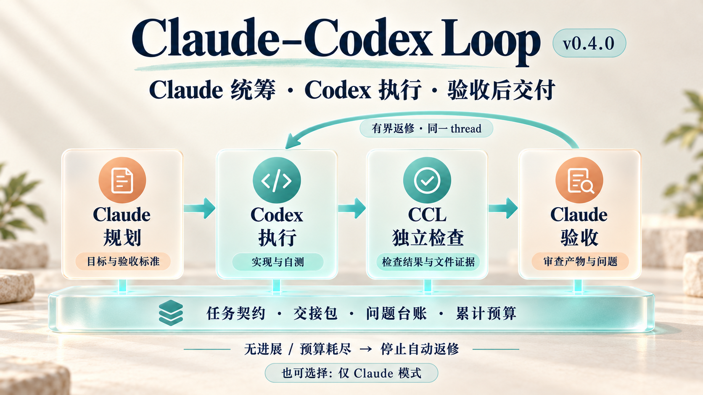

# Claude–Codex Loop

[](LICENSE)

**只和 Claude 对话，让 Claude 定方案、Codex 干活，最后由 Claude 验收。也可以选择全部由 Claude 完成。**



A local, two-mode workflow for Claude Code and Codex CLI: plan → execute → verify → repair → review → shared memory. Python standard library only; uses your existing CLI authentication.

**用户指定模式就照办，没指定就由 Claude 按任务难度自己选，不反问。** 适合 Claude 额度较少、Codex 额度较多的个人工作流；实际额度消耗取决于任务规模，不承诺固定节省比例。

## 两种模式

| 模式 | Claude | Codex |
| --- | --- | --- |
| **1：Claude 统筹 + Codex 执行** | 定方案、验收标准，检查结果 | 修改、分析、运行测试、按反馈返修 |
| **2：仅 Claude** | 独立规划、执行、验证、交付 | 不调用 |

可回复 `1`/`2`/`模式二`/`moshi 2` 等指定；不指定时问答、调研、小改动选模式二，多文件、长耗时、需独立验收的任务选模式一，并在开头一句话说明（回复 `1`/`2` 可改）。详见 [执行模式](docs/modes.md)。

## 快速开始

需要 Python 3.9+、Git，以及已登录的 [Claude Code](https://code.claude.com/docs/en/overview) 与 Codex CLI。

```bash
git clone https://github.com/Yuwangzhi/claude-codex-loop.git
cd claude-codex-loop
python3 install.py            # Windows: python -X utf8 install.py
ccl --version
```

重开 Claude Code 会话后直接说任务，例如“模式一：修复 CSV 导入错误并补回归测试”。环境要求、桌面端 hooks、Windows 与卸载见 [安装与卸载](docs/install.md)。

## 文档

| 文档 | 内容 |
| --- | --- |
| [执行模式](docs/modes.md) | 选模式规则、对话示例、`ccl mode sync` |
| [安装与卸载](docs/install.md) | 环境、安装、桌面端 hooks 通路、安装内容与卸载 |
| [权限](docs/permissions.md) | 为什么不逐条 Yes/No、沙箱与审批设置 |
| [执行闭环](docs/loop.md) | 派发 → 检查 → 返修 → 验收，中断与切换 |
| [共享记忆](docs/memory.md) | `.ai-collab/MEMORY.md` 与候选知识 |
| [契约、交接与预算](docs/budgets-and-contracts.md) | v0.4：spec 绑定、交接包、问题台账、累计预算 |
| [诊断与恢复](docs/diagnostics.md) | `doctor`、`recover`、桌面 hooks 排查 |
| [GitHub、SSH 与 Windows](docs/github-ssh-windows.md) | 凭据、远程调用、Windows 注意事项 |
| [更新记录](docs/changelog.md) | 0.4.0 之后的改动 |
| [开发与验证](docs/development.md) | 测试、目录结构、CI |
| [参考](docs/references.md) | 设计参考与接口文档 |
| [图片说明](docs/visual-assets.md) | 概览图与生成提示词 |

[MIT License](LICENSE)。独立开源项目，与 Anthropic、OpenAI 无隶属关系。
