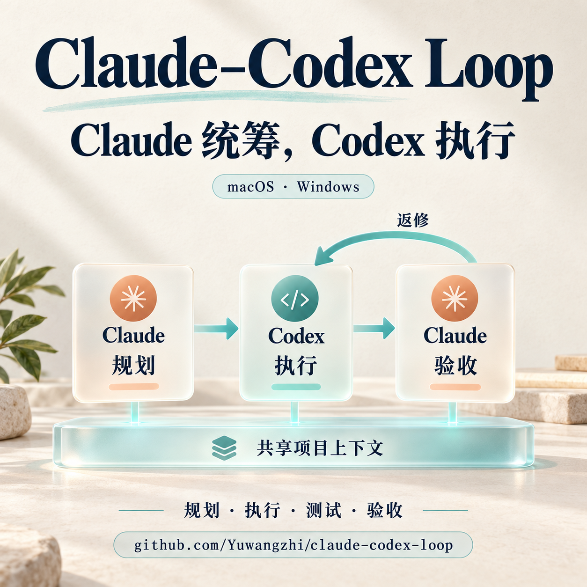
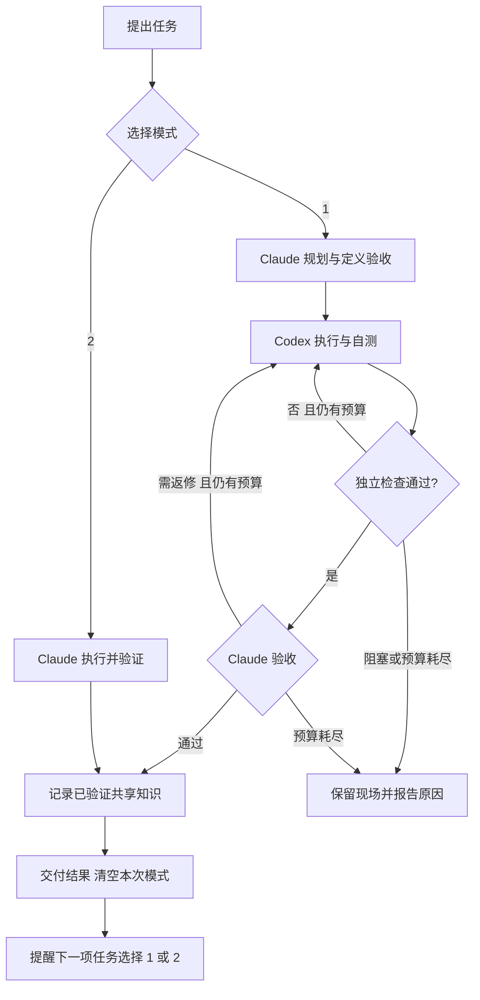

# Claude–Codex Loop

[](LICENSE)

**只和 Claude 对话，让 Claude 定方案、Codex 干活，最后由 Claude 验收。也可以选择全部由 Claude 完成。**



A local, two-mode workflow for Claude Code and Codex CLI: plan → execute → verify → repair → review → shared memory. Python standard library only; uses your existing CLI authentication.

适合 Claude 额度较少、Codex 额度较多，又希望保留 Claude 统筹体验的个人工作流。将大规模执行交给 Codex，可以减少 Claude 承担的执行工作；实际额度消耗取决于任务规模、上下文和返修次数，不承诺固定节省比例。

## 两种模式

| 模式 | Claude 的职责 | Codex 的职责 |
| --- | --- | --- |
| **1：Claude 统筹 + Codex 执行** | 理解需求、形成计划、定义验收标准、检查结果 | 修改代码/文档、分析、运行测试、按反馈返修 |
| **2：仅 Claude** | 独立完成规划、执行、验证和交付 | 不调用 |

每项新任务先选模式。未选择时不执行；同一任务内的补充、检查和返修沿用选择。任务结束后清空本次选择，再提醒下一项任务选 `1` 或 `2`。不同 Claude session 分别保存状态。



## 快速开始

### 1. 准备环境

- Python **3.9+**、Git；macOS/Linux 使用 POSIX shell，Windows 的 Claude Bash 工具使用 Git Bash。
- 能独立工作的 **Claude Code CLI** 和 **Codex CLI**，并完成各自登录。
- Claude 客户端需支持 Claude Code 的本地 skills 和 hooks；普通网页聊天不能直接安装本地 hooks。
- 本项目不安装模型、不创建 API key，不修改模型或供应商。调用使用各自 CLI 账号的额度或计费方式。

| 环境 | 支持范围 |
| --- | --- |
| macOS | 完整 CCL 流程，已有真实 CLI 联调 |
| Linux | POSIX 实现；提供自动测试与可选 CI 模板，尚未进行真实模型联调 |
| WSL | 可作为 Linux 环境使用，未单独进行端到端验证 |
| Windows 原生 | **v0.3.0 起支持完整 CCL**：原生 Python、Windows 文件锁、进程树终止、UTF-8 状态及 `.cmd` / Git Bash 启动器，不需要 WSL |

```bash
python3 --version
git --version
claude --version
codex --version
codex login status
```

### 2. 克隆并安装

```bash
git clone https://github.com/Yuwangzhi/claude-codex-loop.git
cd claude-codex-loop
python3 install.py
export PATH="$HOME/.local/bin:$PATH"
ccl --version
```

安装器复制运行文件、安装两个 skills、追加五类 hooks，并在修改前备份。它保留既有权限、插件配置和其他 hooks；**不会自动打开 Claude 的 Bypass 模式，也不会配置 GitHub 登录或 SSH**。

安装后重新打开 Claude Code 会话。桌面客户端若未加载新 hooks，可在当前任务结束后完全退出再打开，无需重启电脑。更新时再次安装：

```bash
git pull --ff-only
python3 install.py
```

Windows 在 PowerShell 中安装：

```powershell
git clone https://github.com/Yuwangzhi/claude-codex-loop.git
cd claude-codex-loop
python -X utf8 install.py
& "$env:USERPROFILE\.local\bin\ccl.cmd" --version
```

安装器会将用户 `.local/bin` 加到 Windows 用户 PATH 和 Git Bash 启动配置末尾，保留已有 CLI 的优先级。旧窗口的 PATH 不会热更新：重新打开终端和 Claude Code，或者先使用上面的绝对路径。Windows hooks 直接调用安装时的 Python，不依赖终端能否找到 `ccl`；skills 中的 shell 示例使用 Git Bash。npm 安装的 Codex 通过其 Node 入口启动，避免 `.cmd` 再次解析 JSON 参数。

### 3. 和 Claude 对话

```text
你：帮我修复项目中的 CSV 导入错误。
Claude：本次用模式一（Claude 统筹、Codex 执行），还是模式二（全部由 Claude 完成）？
你：1
Claude：制定计划 → 交给 Codex → 检查结果 → 必要时返修 → 交付。
Claude：下一项任务用模式一还是模式二？回复 1 或 2。
```

也可以把模式与任务一起提交：

```text
模式一：修复 CSV 导入错误，补充有意义的回归测试。
模式二：解释这个函数的逻辑，不修改文件。
/codex-loop 为这个目录生成一份结构说明。
```

`/codex-loop` 是显式选择模式一的快捷入口；`/work-mode` 加载模式管理规则。目前使用中文提示，识别“模式一/二”、等待选择时单独的 `1/2` 等输入。空白页面是否显示启动提示取决于客户端；hooks 不会凭空生成一条模型消息，首次输入后的对话会明确询问选择。

## 权限：为什么不会逐条要求 Yes / No？

CCL 统一使用非交互的 `codex exec`，新任务默认显式传入：

```text
approval_policy = "never"
sandbox_mode = "danger-full-access"
```

**这是当前用户账户的完整本机访问权限：模型生成的命令不再受 Codex 工作区沙箱限制，也不会逐条请求执行批准。** 只在你愿意授予这种访问的环境使用。它不授予 root/管理员身份，不等于允许任意发布、发送消息或破坏数据；任务范围仍必须明确。

需要限制单个任务时：

```bash
ccl new --project /absolute/project --spec task.json --sandbox workspace-write
ccl new --project /absolute/project --spec task.json --sandbox read-only
```

两种限制仍配合 `approval_policy=never`：超出权限时失败或报告阻塞，不通过弹窗升级权限。首次执行和返修沿用任务记录里的设置；旧任务和已启动进程不会自动改变权限。

Claude 调用 Bash 是**另一层权限**。希望 Claude 也不逐条询问时，可在 Claude Code 中选择 Bypass permissions，或按[官方说明](https://code.claude.com/docs/en/permissions)配置 `permissions.defaultMode: "bypassPermissions"`。安装器保留已有值。系统登录、OTP、操作系统授权和浏览器工具自身的强制确认不由 CLI 开关取消。

不要另开带 `on-request` 或 `--full-auto` 的交互终端覆盖预期权限。GitHub 登录失败也不是提高沙箱权限就能解决的问题。

## 闭环是怎样实现的？

1. **Claude 写任务**：目标、计划、约束、交付物、验收条件和真实检查命令。
2. **CCL 调用 Codex**：保留 JSONL 事件、结构化结果和明确的 thread ID。
3. **独立检查**：运行事先定义的检查，核对文件存在，记录 SHA256 与 Git 状态。
4. **自动返修**：失败证据交回同一个 Codex thread。默认总共最多 3 次执行，每次最长 30 分钟。
5. **Claude 验收**：`awaiting_review` 只是候选结果；阅读 diff、报告或渲染结果后才能接受。接受前再次比较产物和 Git 指纹。
6. **记录知识并交付**：验收后的事实进入共享记忆，再结束本次模式。

身份验证、进程错误和明确阻塞不会无限重试。记录可用于恢复，但本项目不会后台唤醒 Claude 自动验收。

### 手动体验执行器

通常由 Claude 调用这些命令。这个例子可独立验证执行器，不绑定 Claude session；独立 CLI 操作者负责自己的模式选择和最终审查。

```bash
TASK_SPEC="$PWD/examples/report-task.json"
DEMO_DIR="$(mktemp -d)"
ccl new --project "$DEMO_DIR" --spec "$TASK_SPEC" --sandbox workspace-write
# 从上一步 JSON 输出中取 id，替换下方 TASK_ID
ccl run TASK_ID
ccl status TASK_ID
cat "$DEMO_DIR/report.json"
# 实际检查正确后再接受
ccl review TASK_ID accept --note '已阅读 report.json，内容与目标一致，独立检查通过'
```

[示例 JSON](examples/report-task.json) 展示完整格式。`checks[].argv` 是参数数组，不自动解释为 shell 字符串；需要 shell 时显式指定。验收命令使用本机当前用户权限。没有自动检查的视觉或分析任务也需真实产物，由 Claude 实际审查。

## 共享记忆

双方读取**同一组明确的文件**，不会自动合并私有聊天历史或模型内部记忆。

| 内容 | 默认位置 | 写入方式 |
| --- | --- | --- |
| 项目事实、决策与验证依据 | `PROJECT/.ai-collab/MEMORY.md` | 模式一验收后 `ccl remember`；模式二检查后 `ccl note` |
| 通用协作规则 | `~/.config/claude-codex-loop/SHARED_MEMORY.md` | 安装器维护标记区块，保留其他内容 |
| 可选本机访问说明 | `~/.config/claude-codex-loop/ACCESS_HANDOFF.md` | 用户自行提供；不存在时跳过 |
| 模式选择 | `~/.local/state/claude-codex-loop/sessions/` | 按 session 隔离，不写入项目事实记忆 |
| 执行与审查记录 | `~/.local/state/claude-codex-loop/projects/` | 保存任务、尝试、检查和审查记录 |

Codex 的 `memory_proposals` 只是候选知识，由 Claude 验收后决定是否记录。不要放入 token、密码、完整日志或未经验证的猜测。本仓库忽略 `.ai-collab/`；其他项目如需保持记忆私有，也应加入其 `.gitignore`。

## 中断、返修与切换

| 场景 | 处理方式 |
| --- | --- |
| 查看现有任务 | `ccl context --project PATH`、`ccl status TASK_ID` |
| 要求返修 | `ccl review TASK_ID revise --note '具体问题和证据'`，随后 `ccl run TASK_ID` |
| 新 session 接续旧任务 | 先选模式一并核对现场，再 `ccl adopt TASK_ID --session SESSION_ID` |
| 切到模式二 | 停止并等待旧 worker 退出、保留成果、关闭旧任务，再激活待切换模式 |
| 硬中断 | 核对进程、文件和外部状态，再按原记录恢复，避免重复副作用 |
| 预算耗尽 | 报告证据并调整计划，不断新建相同任务不能绕过上限 |

同一项目用文件锁串行执行。孤儿进程未排查前不允许直接重放。模式 hooks 是工作流约束，不是抵御任意绕过方法的安全沙箱。详情见 `ccl --help` 和各子命令的 `--help`。

## GitHub、SSH 与 Windows

CCL 使用调用进程已有的 PATH、网络和登录环境，不附带个人凭据，不复制登录，也不自动配置远程机器。每台执行机器应独立验证：

```bash
gh auth status
gh api user --jq .login
gh auth setup-git --hostname github.com
git ls-remote https://github.com/OWNER/REPOSITORY.git HEAD
ssh -o BatchMode=yes YOUR_HOST whoami
```

`gh auth setup-git` 会将 GitHub HTTPS 的 Git 凭据助手配置为 GitHub CLI。其他托管服务需各自认证。Mac 可访问不代表 Windows 的 token 或 SSH 会话有效；在**实际执行任务的账号与 shell**里验证，不把 token 填进任务、remote URL 或日志。

Windows 原生现在可以安装完整 CCL；推荐由 Claude 使用 `ccl new/run` 获得同样的状态、独立检查和共享记忆。下面是额外的直接 CLI 调用方式，这种手动通路本身不包含 CCL 闭环：

```bash
# Claude 调用 Codex 的基本形式
codex exec -c 'approval_policy="never"' -c 'sandbox_mode="danger-full-access"' '明确的任务与验收条件'

# 独立 Codex 会话经用户要求后调用 Claude 的基本形式
claude -p --permission-mode bypassPermissions '明确的任务；不要再次反向委派'
```

CCL worker 不允许再反向调用 Claude，避免无限互调。不同客户端的工具集、浏览器能力和插件可能不同；权限开放不等于能力齐全。

## 安装内容与卸载

```text
~/.local/bin/ccl                              启动器
~/.local/bin/ccl.cmd                          Windows 原生命令入口
~/.local/share/claude-codex-loop/              Python 运行文件
~/.claude/skills/work-mode/                   两模式入口
~/.claude/skills/codex-loop/                  Codex 闭环技能
~/.claude/settings.json                      追加五类 hooks
~/.claude/CLAUDE.md                          带标记的 Claude 指令
~/.codex/AGENTS.md                           带标记的 Codex 指令
~/.local/state/claude-codex-loop/backups/     备份与 manifest
```

五类 hooks 为 SessionStart、UserPromptSubmit、PreToolUse、PostToolUse、Stop；PostToolUse 只匹配模式选择的 AskUserQuestion。重复安装不重复添加同一 hook。安装是用户级的，新 Claude Code 会话都会应用模式规则。

卸载时先停止 CCL 任务，再删除 CLAUDE.md、AGENTS.md、SHARED_MEMORY.md 中 `BEGIN/END claude-codex-loop` 区块；从 settings 中仅移除指向 CCL 启动器的 hooks；删除两个 skills、启动器和运行文件。任务记录与项目记忆可保留。回退时对照备份 manifest 逐项恢复，避免整体覆盖安装后新改过的设置。

Windows hooks 的命令直接指向 `ccl.py hook`，卸载时只移除这些项；还可移除 Git Bash 配置中 `# CCL user-local executables` 对应行。`.local/bin` 若还有其他工具，不要从 PATH 整体移除。Windows 安装备份额外包含用户 PATH 的原值。

高级变量：`CCL_STATE_DIR` 更改状态目录，`CCL_CONFIG_DIR` 更改共享配置目录，`CCL_CODEX_BIN` 指定 Codex 可执行文件。这些控制执行器运行时，不改变安装器位置；同一流程需使用一致的值。

## 开发与验证

```bash
python3 -X utf8 -m unittest discover -s tests -v
# Windows: python -X utf8 -m unittest discover -s tests -v
```

自动测试不需要模型登录，不发出付费模型调用。覆盖返修、检查失败、产物变化、预算、锁与中断、共享记忆、模式隔离、安装保留设置和失败回退。v0.3.0 在 **macOS 与 Windows 各 38/38 通过**，新增跨进程锁、无副作用 PID 查询、超时子进程终止及 PowerShell 模式门控检查；真实模型联调与自动测试的证据边界见 [VALIDATION.md](VALIDATION.md)。

可选 [GitHub Actions 模板](examples/github-actions.yml) 提供 macOS/Linux/Windows × Python 3.9/3.12 矩阵。要启用它，将文件复制到 `.github/workflows/tests.yml` 后提交；提交凭据需要允许写入 workflow。当前仓库没有启用云端 CI，不把本地测试当作云端测试结果。

```text
ccl.py                任务执行、验证、审查、记忆与 hook 入口
modes.py              session 模式状态与选择门控
runtime.py            Windows/POSIX 锁、进程检查和启动兼容层
install.py            备份、增量安装和失败回退
claude-skill/         Claude 统筹 / Codex 执行规则
mode-skill/           两模式选择与收尾规则
examples/             可运行的任务样例
tests/                不调用真实模型的测试
```

## 参考与许可

设计参考：[myclaude](https://github.com/stellarlinkco/myclaude)、[codex-handoff](https://github.com/tk-47/codex-handoff)、[claude-codex-handoff](https://github.com/OpenMOSS/claude-codex-handoff)。借鉴规划、持久交接和验收思路，未复制其实现。

接口文档：[Codex 非交互模式](https://developers.openai.com/codex/noninteractive/)、[Claude skills](https://code.claude.com/docs/en/skills)、[Claude hooks](https://code.claude.com/docs/en/hooks)、[Claude permissions](https://code.claude.com/docs/en/permissions)、[GitHub CLI 凭据助手](https://cli.github.com/manual/gh_auth_setup-git)。

[MIT License](LICENSE)。独立开源项目，与 Anthropic、OpenAI 无隶属关系。
