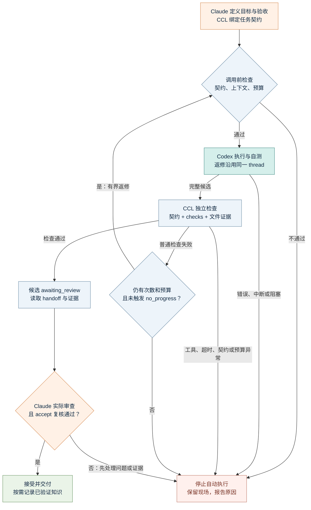

# 闭环是怎样实现的？

← [返回 README](../README.md)

1. **定义并绑定任务**：Claude 写明目标、计划、约束、交付物、验收条件和检查命令；CCL 绑定 spec SHA256，以及可选的 `verification_files` 内容。
2. **准备交接并执行**：调用前核对契约、装配上下文、检查剩余预算；保存上下文与交接快照，再启动 Codex，保留 JSONL 事件、结构化结果和 thread ID。
3. **独立检查并留证**：CCL 运行原任务定义的 checks，核对产物，记录文件 SHA256、Git 状态和检查回执；检查前后都核对契约。这里是独立执行检查命令，不是另开一个审查模型。
4. **有界返修或停止**：普通检查失败可将证据交回同一个 Codex thread；默认总共最多 3 次执行，单次 worker 最长 30 分钟，并受累计预算约束。触发 `no_progress`、预算耗尽或环境/执行异常时停止自动返修。
5. **Claude 审查并接受**：`awaiting_review` 只是候选。通过 `ccl handoff TASK` 阅读证据、实际检查 diff/产物并处理问题台账；accept 前再次核对契约、回执、产物和 Git 指纹，未解决或过期 finding 会阻止接受。
6. **按需记忆并交付**：验收后由统筹方选择已验证知识写入共享记忆，再结束本次任务、保留模式偏好；候选知识不会自动成为已确认事实。



上图展示 `run → review` 主路径。**停止自动推进不等于关闭任务**；统筹方核查原因后，按下表显式处置，不会自动走恢复分支。

| 现场情况 | 显式处置 | 回到哪里 |
| --- | --- | --- |
| 仅问题台账待处理 | 审查证据，按实际情况 `finding resolve`；不能把待处理项直接当成已修复 | 重新审查并 `review accept`；不必启动 worker |
| 实现需要修改，或触发 `no_progress` | 查明原因，`review revise --note '具体证据'` 后 `run`；仍须有次数与预算 | 调用前检查，再用同一 thread 执行 |
| 验收工具已恢复，或当前完整候选需要重验 | 满足状态、锁、契约和剩余检查时间等条件后，`recover --reverify --note '核查依据'` | 只运行原 checks；通过回到 `awaiting_review`，未通过继续停下，**不自动调用 Codex** |
| 契约改变、预算耗尽，或暂时无法安全继续 | 保留证据并报告；确需新方案时重新审定，不清空原任务记录来绕过上限 | 不自动恢复 |

`no_progress` 只检测连续相同失败检查与产物哈希；显式返修和重验都不重置预算。token 限额在下一次 worker 调用前检查，不是调用内实时截断。accept 会核对契约、检查回执、产物与 Git 指纹，以及是否仍有未解决/过期 finding；明确驳回或延期的问题不冒充已修复。

身份验证、进程错误和明确阻塞不会自动重试。`ccl doctor --compat` 可在安装或 CLI 更新后手动做兼容检查，不在每轮执行中自动运行，也不证明登录或工具能力。记录可用于恢复，但本项目不会后台唤醒 Claude 自动验收。

## 手动体验执行器

通常由 Claude 调用这些命令。这个例子可独立验证执行器，不绑定 Claude session；独立 CLI 操作者负责自己的模式选择和最终审查。

```bash
TASK_SPEC="$PWD/examples/report-task.json"
DEMO_DIR="$(mktemp -d)"
ccl new --project "$DEMO_DIR" --spec "$TASK_SPEC" --sandbox workspace-write
# 从上一步 JSON 输出中取 id，替换下方 TASK_ID
ccl run TASK_ID
ccl status TASK_ID
cat "$DEMO_DIR/report.json"
# 实际检查正确后再接受
ccl review TASK_ID accept --note '已阅读 report.json，内容与目标一致，独立检查通过'
```

[示例 JSON](../examples/report-task.json) 展示完整格式。`checks[].argv` 是参数数组，不自动解释为 shell 字符串；需要 shell 时显式指定。验收命令使用本机当前用户权限。没有自动检查的视觉或分析任务也需真实产物，由 Claude 实际审查。

## 中断、返修与切换

| 场景 | 处理方式 |
| --- | --- |
| 查看现有任务 | `ccl context --project PATH`、`ccl status TASK_ID` |
| 要求返修 | `ccl review TASK_ID revise --note '具体问题和证据'`，随后 `ccl run TASK_ID` |
| 新 session 接续旧任务 | 确认当前为模式一，核对现场，再 `ccl adopt TASK_ID --session SESSION_ID` |
| 切到模式二 | 停止并等待旧 worker 退出、保留成果、关闭旧任务，再激活待切换模式 |
| 硬中断 | 核对进程、文件和外部状态，再按原记录恢复，避免重复副作用 |
| 预算耗尽 | 报告证据并调整计划，不断新建相同任务不能绕过上限 |

同一项目用文件锁串行执行。孤儿进程未排查前不允许直接重放。模式 hooks 是工作流约束，不是抵御任意绕过方法的安全沙箱。详情见 `ccl --help` 和各子命令的 `--help`。
