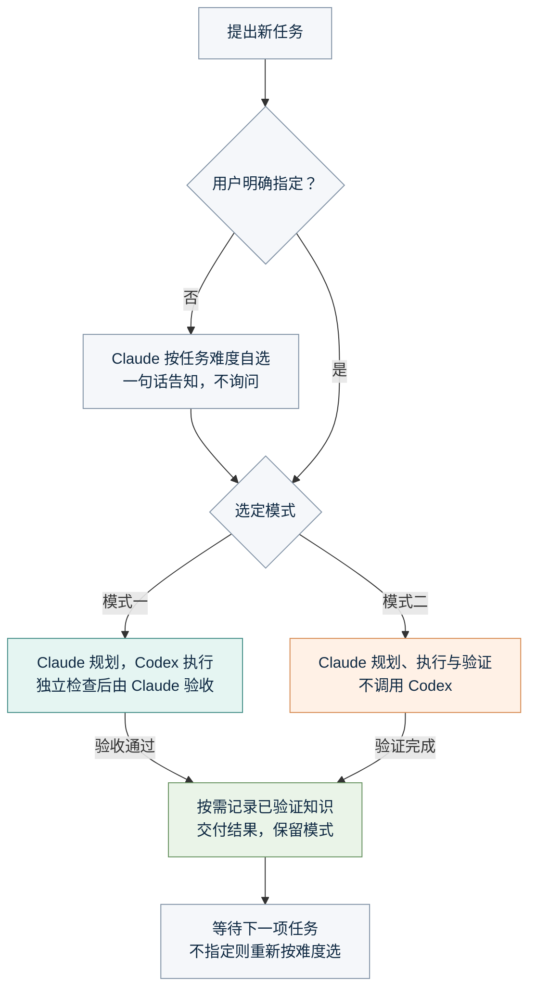

# 执行模式

← [返回 README](../README.md)

## 两种模式

| 模式 | Claude 的职责 | Codex 的职责 |
| --- | --- | --- |
| **1：Claude 统筹 + Codex 执行** | 理解需求、形成计划、定义验收标准、检查结果 | 修改代码/文档、分析、运行测试、按反馈返修 |
| **2：仅 Claude** | 独立完成规划、执行、验证和交付 | 不调用 |

**用户指定了就照办，没指定就由 Claude 按任务难度自己选，不会反问。** 可回复 `1`、`2`、`一`、`二`、`模式1`、`模式二`、`mode 2`、`moshi 2`，也接受“二吧”“就用1”“用模式二做”等表达。未指定时：问答、调研、小改动、配置部署等几步内能做完的任务选模式二；多文件、长耗时、批量、需要独立验收的任务选模式一（直接 `ccl new` 即记为模式一）。Claude 会在开头用一句话说明所选模式，回复 `1`/`2` 可随时改。同一任务内的补充、检查和返修继续当前模式；新任务难度明显不同时，Claude 自选的模式可以重选，用户明确选过的不会被改。其他窗口的选择不会切换正在执行的任务。



模式一的返修、阻塞与停止分支见[执行闭环](loop.md)。模式二不经过 CCL 的 Codex 任务执行器；两种模式都不会仅因时间流逝而自动开始下一项任务。

### 3. 和 Claude 对话

```text
你：帮我修复项目中的 CSV 导入错误，涉及几个模块并要补测试。
Claude：本次按难度选模式一（多文件 + 需独立验收），回复 2 可改为仅 Claude。制定计划 → 交给 Codex → 检查结果 → 必要时返修 → 交付。
你：继续修复导出功能。
Claude：同一任务，沿用模式一。
你：顺便把 README 里的版本号改一下。
Claude：这是单文件小改动，改用模式二自己做。
你：模式一：把整个目录的测试补全。
Claude：按你的指定用模式一。
```

也可以把模式与任务一起提交：

```text
模式一：修复 CSV 导入错误，补充有意义的回归测试。
模式二：解释这个函数的逻辑，不修改文件。
/codex-loop 为这个目录生成一份结构说明。
```

`/codex-loop` 是显式选择模式一的快捷入口；`/work-mode` 加载模式管理规则。普通任务中的数字、“看一下”等词，以及同时提到两个模式但没有作出选择的句子，不会被硬猜成某个模式。未指定模式的任务由 Claude 自选，并在回复中明确说明；自选不等同于用户的显式选择，用户随后回复 `1`/`2` 即以用户为准。

空白页面是否显示启动提示取决于客户端；hooks 不会凭空生成一条模型消息。若桌面端 hook 没有记录已经提交的选择，可运行 `ccl mode sync --session SESSION_ID`，从真实会话记录恢复。未选择模式时 hook 不会拦截任何工具调用，也不再要求在回复末尾附选择菜单或强制调用 `mode finish`（回合结束时自动保持当前模式）。无需让模型伪造输入。没有新任务输入时不会后台自动开始工作。
